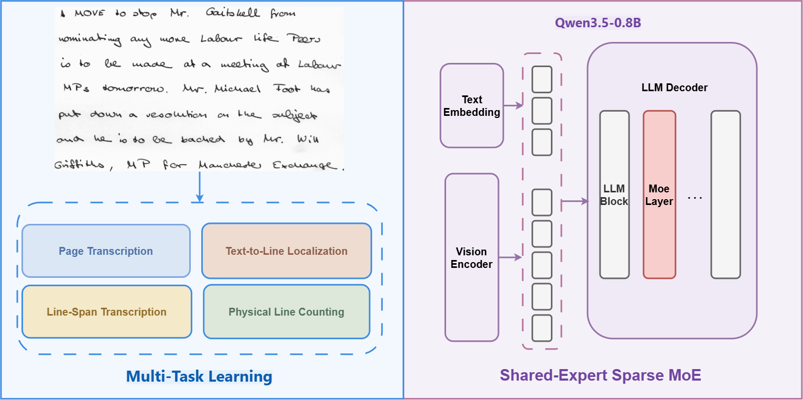

# ExpertHTR

<p align="center"><em>Unified Handwritten Text Recognition with Multi-Task Learning and Sparse Mixture-of-Experts</em></p>

<p align="center">
  Dang Hoai Nam &middot; Nguyen Duy Hieu &middot; Vo Nguyen Le Duy
</p>

<p align="center">
  <a href="https://huggingface.co/datasets/DAIR-Group/ExpertHTR-Dataset">
    
  </a>
</p>

ExpertHTR is a handwritten text recognition system built on
[Qwen3.5-0.8B-Base](https://huggingface.co/Qwen/Qwen3.5-0.8B-Base). It learns
four related tasks together—page transcription, line counting, phrase-to-line
localization, and line-span transcription—and uses a Sparse Mixture-of-Experts
(MoE) layer to adapt the model for diverse handwriting datasets.

<p align="center">
  
</p>

## Highlights

* Multi-task training for page-level handwritten text recognition.
* Sparse MoE with four routed experts and one shared expert.
* Evaluated on seven handwriting benchmarks: BRESSAY, Bentham, HWDB2.0, IAM,
  ICFHR2016, RIMES, and ScribbleLens.
* **2.92% CER on IAM page-level evaluation** in the current manuscript table.

## Installation

Python 3.10+ and a CUDA-capable GPU are recommended for training.

```bash
git clone <YOUR_GITHUB_REPOSITORY_URL>
cd ExpertHTR

python -m venv .venv
source .venv/bin/activate

python -m pip install --upgrade pip
python -m pip install -e .
python -m pip install -r requirements-core.txt
```

You also need a local copy of Qwen3.5-0.8B-Base and a dense HTR initialization
checkpoint. The repository does not include model weights or raw datasets.

## Data and checkpoints

Set paths to your local data, model, checkpoint, and output directory:

```bash
export HWVLM_DATA_ROOT=/path/to/mthtr
export HWVLM_MODEL_NAME=/path/to/Qwen3.5-0.8B-Base
export HWVLM_DENSE_INIT_CHECKPOINT=/path/to/dense/checkpoint
export HWVLM_OUTPUT_ROOT=/path/to/outputs
```

The reference experiment uses 20,388 training, 962 validation, and 1,327 test
records. Follow the original access terms for each dataset. More details are in
[DATA_LICENSES.md](DATA_LICENSES.md) and
[docs/DATASET_AND_TASKS.md](docs/DATASET_AND_TASKS.md).

## Training and evaluation

```bash
# Check that the package is installed correctly.
experthtr --validate-imports

# Audit the dataset and token budget before a new experiment.
experthtr audit

# Train Sparse MoE from the dense HTR checkpoint.
experthtr train

# Evaluate the checkpoint selected on validation data.
HWVLM_FINAL_TEST_CHECKPOINT=/path/to/selected/checkpoint experthtr final-test
```

See [docs/CLI.md](docs/CLI.md) for all commands and
[docs/REPRODUCIBILITY.md](docs/REPRODUCIBILITY.md) for the full experiment setup.

## Results

CER (%) on the seven evaluation datasets; lower is better.

| Method         |     BRES. |     Bent. |     HWDB |      IAM |      READ |    RIMES |    Scrib. |
| -------------- | --------: | --------: | -------: | -------: | --------: | -------: | --------: |
| Qwen3.5 Base   |     51.94 |     27.13 |    25.43 |    11.55 |    124.49 |    31.66 |     91.45 |
| **Sparse MoE** | **19.96** | **17.57** | **4.63** | **2.92** | **52.23** | **5.59** | **42.52** |

The complete comparison table and notes are in [docs/RESULTS.md](docs/RESULTS.md).

## Repository structure

```text
ExpertHTR/
├── configs/           # Reference configuration and path template
├── docs/              # Architecture, data, evaluation, and reproducibility notes
├── examples/          # Optional notebook walkthrough
├── scripts/           # Release checks and run-manifest utility
├── src/experthtr/     # Main Python package
├── DATA_LICENSES.md   # Dataset license and provenance boundary
├── MODEL_CARD.md      # Model and checkpoint release information
└── requirements-core.txt
```

## Citation

Please cite the accompanying manuscript if you use ExpertHTR. Temporary
metadata is available in [CITATION.cff](CITATION.cff) and will be updated with
the final venue and DOI.

## License

The original ExpertHTR code is released under the
[Apache-2.0 License](LICENSE). Datasets, base-model weights, and fine-tuned
checkpoints have separate licenses and are not redistributed in this repository.
